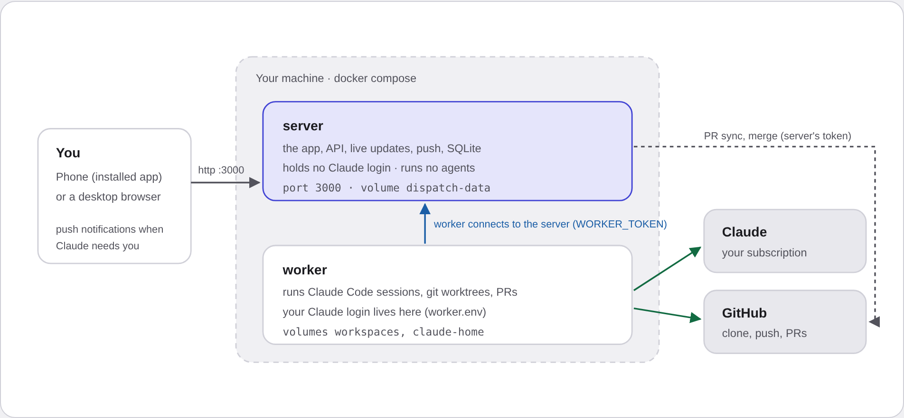
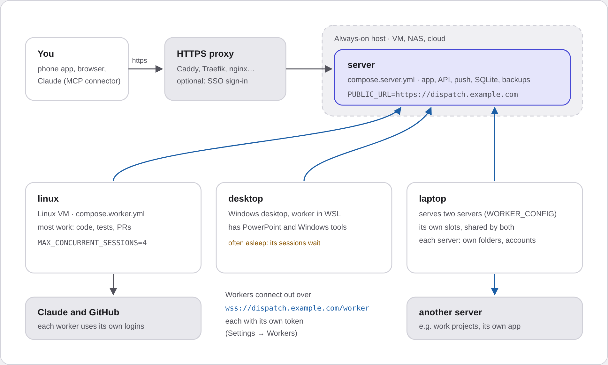
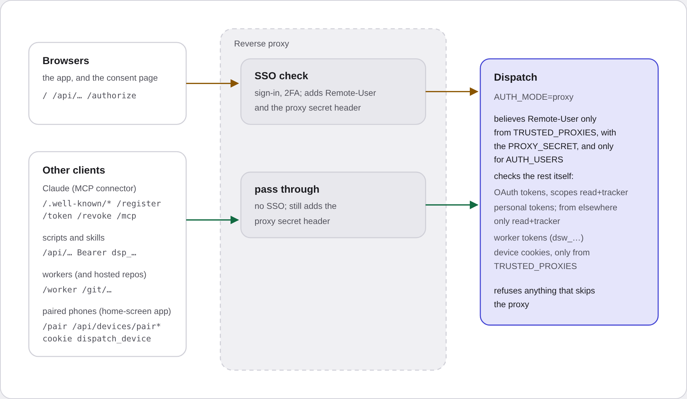

# Dispatch

A personal, Linear-style tracker for your projects that also runs **Claude Code** on them.

- Projects → one or more GitHub repos → backlog items and bugs, with per-project **importance**
  (4 levels) and **effort** (t-shirt by default) scales.
- **Sources**: capture a retro, skill-run report or user report (reporter + version tag), and split
  it into linked items, by hand or with Claude.
- Mark items and **start a batch**: one Claude Code session (with superpowers) works on one branch
  and opens one PR per changed repo.
- Or open a **planning chat**: Claude reads the code and the tracker and proposes the next batch as
  a card you edit and start.
- Sessions are normal multi-turn Claude Code. Claude's questions and plan approvals show up as
  cards, with a **push notification** to your phone. **Activity** shows all running work across
  projects and the open item discussions (drag one left, or **Close** on desktop, to close it; one
  untouched for 10 days drops out). Its search box finds older chats by their words, project, kind
  and dates.
- If a worker's Claude account is logged out, the session shows the steps to sign in again on that
  machine and a **Retry** that resumes the session where it stopped. Settings shows each account's
  state.
- Review the PR diff on your phone and **merge** on GitHub, or merge locally on the worker and push.
- An **Assistant** tab (Haiku by default) that runs the tracker for you: "new project Decks for
  github.com/me/decks", "read ~/notes/retro.md and file the issues under Decks". It changes
  projects, repos, items and sources at once. To start agent work it shows a card you confirm. It
  can read files only in `ASSISTANT_READ_DIRS` and cannot edit files or run commands.
- **Discuss this** on any item: a read-only Haiku chat (`DISCUSS_MODEL`) that knows the item and the
  repo's `CLAUDE.md`, and can read the code in the project's repos (or the folder an imported source
  came from). It never changes anything; starting work stays on the item page.
- Planning and discussion chats can **reach other projects**: to search one, read one of its items
  or comment on it, Claude asks you first with a card that shows the request (or the exact comment).
  Nothing is read or written without your yes. Scheduled planner runs cannot do this.
- **Local repos** (no GitHub): add a project repo as a folder path (inside `LOCAL_REPO_DIRS`).
  Agents push their branches into that folder; Dispatch shows the branch for review (diff on the
  phone) and merges it by pushing the default branch back (the folder's working tree must be clean;
  set `receive.denyCurrentBranch updateInstead` there if the branch is checked out).
  The same repo can have a copy on several workers, each at its own path (add the folder on the
  other worker, or set the path in the repo's settings). Sessions run only on a worker whose copy
  checks out (same repo, still there), and merges land in the copy on the worker the session ran on.
- **Live test progress**: while a repo's check command runs before a merge, the session shows the
  step, the last finished test file, passed and failed counts, and the time left, estimated from
  earlier passing runs of the same command (vitest, playwright and pytest output is read; any other
  command still gets the time estimate). Runs answered from a cache are left out of the estimate.
  The check runs without locking the repo, for up to `CHECK_TIMEOUT_MIN` on the worker; if the
  default branch moved on meanwhile, nothing is pushed and you merge again.
- **Check before done**: when a work session's turn ends, the check command of each repo the
  session changed runs in its worktree before the turn is reported done (with the same live
  progress). A failure goes back to the agent with its output as the next turn, up to
  `CHECK_RETRIES` fix turns; then you get a push that it still fails. An unchanged worktree is not
  checked again. A batch can turn this off ("Run the repo's check before done").
- **Generated files at merge**: a repo's generate command (repo settings) runs in the merge
  checkout after the merge and before the check, with `DISPATCH_ITEMS` set to a JSON file of the
  project's items (the merging batch's items done). Its changes to the repo's generated files
  (e.g. `backlog.md`) go into the merge commit itself; a failure blocks the merge, and so does a
  branch that edits a generated file by hand. Such repos always merge in Dispatch, never on GitHub.
- **Deploy after merge**: a repo's deploy command (repo settings) runs on the session's worker
  each time Dispatch merges into its default branch, by auto-merge or by you. A local repo deploys
  from its folder, other repos from a fresh checkout of the merged branch; `DISPATCH_DEPLOY_SHA`
  holds the merged commit. Deploys of one repo run one at a time. The result goes into the session,
  and the push says "merged and deployed" or that the deploy failed, with the end of its output.
  The deploy may restart the server itself: the worker keeps the result and reports it when the
  server is back. If it restarts the worker, do that last, detached (e.g. `systemd-run --user …`).
- **Accounts**: several GitHub accounts (a project picks one; its repos and commits use it) and several
  Claude accounts (a project has a default and an allowed list; a batch can pick another allowed one; a
  session keeps its account). SSO accounts log in once with `CLAUDE_CONFIG_DIR=… claude`. The Assistant
  has its own account setting. Secrets stay in env; see `.env.example`.
- **Several people** on one install (sign-in proxy with `AUTH_USERS`): each person connects their own
  GitHub account (Settings → Your GitHub), and the sessions they start clone, push, open PRs and merge
  as them. See [Several people](#several-people).
- **Disable a project** (the lock on the project page, or its Settings): it becomes read-only. Every
  write to it is refused (app, API, `/mcp` and the agents' tools) with a message that says how to
  enable it; reads still work. Its schedules pause and come back as they were when you enable it.
  Its queued sessions wait; a running session goes on until you stop it.
- Links in item text open in the app: repo files (markdown rendered, images shown), and `#anchor`
  links to other items imported from the same backlog.

Design spec: [`docs/superpowers/specs/2026-10-14-dispatch-design.md`](docs/superpowers/specs/2026-10-14-dispatch-design.md).

## Getting started

Dispatch has two parts. The **server** is the app you open (projects, backlog, sessions, push
notifications) and keeps the data; it holds no Claude login and runs no agents. A **worker** runs
the Claude Code sessions, with your Claude login and git, and connects *out* to the server. Run both
on one machine to start; add workers on other machines when you need them.

| You want | Use |
|---|---|
| To try it, or one always-on box | [One machine with Docker](#one-machine-with-docker) |
| The app always up, agents on the machines that have the tools (a Windows desktop with Office, a Linux VM) | [Distributed setup](#distributed-setup) |
| Sign-in through your SSO (Authelia, Authentik, …) | [Sign-in behind a proxy](#sign-in-tokens-and-claude-connectors) |

Illustrations (open the HTML files for light and dark versions):
[one machine](docs/illustrations/one-machine.html) ·
[distributed](docs/illustrations/distributed.html) ·
[behind a sign-in proxy](docs/illustrations/proxy-routes.html).

### One machine with Docker



You need Docker with Compose, a Claude subscription (or an API key), and optionally a GitHub token.

```bash
git clone https://github.com/<you>/dispatch && cd dispatch
cp docker/server.env.example server.env
cp docker/worker.env.example worker.env
# one shared secret between the two:
T=$(openssl rand -hex 32)
for f in server.env worker.env; do sed "s/^WORKER_TOKEN=.*/WORKER_TOKEN=$T/" $f > $f.new && mv $f.new $f; done
```

1. In `server.env`, set `APP_PASSWORD`, and `GITHUB_TOKEN` if you use GitHub (a fine-grained token
   with *Contents* read/write, *Pull requests* read/write and *Actions* read, on your repos; a
   classic token with `repo` works too).
2. In `worker.env`, set `CLAUDE_CODE_OAUTH_TOKEN`: run `claude setup-token` on your own computer and
   paste the token (to bill the API instead, set `ANTHROPIC_API_KEY`). Set the same `GITHUB_TOKEN`
   and your commit name and email. To try the app without using Claude, set `RUNNER=fake`.
3. Start it and open the app:

   ```bash
   docker compose up -d --build
   open http://localhost:3000            # sign in with APP_PASSWORD
   ```

4. Make a project, add a repo (`owner/name`), add a few items, and start a batch, or ask the
   planner what to do next (**Plan** on the project).

**Scheduled runs.** On a project's Sessions tab, **Add schedule** makes the planner run at set times
(for example every night at 02:00). Each schedule has its own scope in prose (modules, tags, "triage
new bugs first"), a limit on the number of batches per run, and run options for those batches. The
run asks nothing. It starts the batches it picks, or nothing if no work fits. It never starts items on
hold, in progress or in review, and it cannot take an item off hold. It can triage items when the
scope says so. The run shows in the session list, and its last message is the result. Times are in
the server's time zone: `TZ`, default `UTC` in Docker (see [Configuration](#configuration)). A run missed while the server was down
starts when the server is back, if that is less than 6 hours after its time.

The **phone app** and **push notifications** need HTTPS: put a reverse proxy in front and set
`PUBLIC_URL` to the https address ([Caddy example](docs/examples/Caddyfile)). Then open the address
on the phone and add it to the home screen. Data is in the Docker volumes (`dispatch-data` for the
server, `workspaces` and `claude-home` for the worker).

### Distributed setup



**1. The server**, on an always-on host (a VM, a NAS, a cloud box):

```bash
cp docker/server.env.example server.env    # APP_PASSWORD, PUBLIC_URL=https://dispatch.example.com, GITHUB_TOKEN
docker compose -f compose.server.yml up -d --build
```

Put HTTPS in front ([Caddy example](docs/examples/Caddyfile)); the worker socket `/worker` and live
updates are ordinary WebSocket/HTTP traffic and pass through. `compose.server.yml` also runs a
nightly backup of the database into `./backups` (14 days kept). `WORKER_TOKEN` in `server.env` is
optional here: workers get their own tokens.

**2. A worker for each machine.** In the app, **Settings → Workers → New worker**: give it a name
(`linux`, `desktop`) and a description the planner reads ("Windows desktop, has PowerPoint, often
asleep"). Copy the token it shows once (`dsw_…`).

Setting up the machine itself is the longer part. **Settings → Workers → Set up a new worker** has the
steps below as a page, and a prompt you paste into an LLM (Claude Code, say) on the new machine, which
then walks you through them: it clones the code, writes the config, checks the Claude and GitHub
sign-ins and starts the service. The prompt holds the server address, the build and the worker's name
and description, never a token: you paste that into the config file yourself.

*With Docker* (a Linux VM, a server):

```bash
cp docker/worker.env.example worker.env
# SERVER_WS_URL=wss://dispatch.example.com/worker, WORKER_TOKEN=dsw_…, CLAUDE_CODE_OAUTH_TOKEN, GITHUB_TOKEN
docker compose -f compose.worker.yml up -d --build
```

*Without Docker* (a desktop, so agents can use its programs; under WSL they can run Windows tools
such as PowerPoint): Node 24 or newer and git, then

```bash
git clone https://github.com/<you>/dispatch ~/dispatch && cd ~/dispatch && npm ci --omit=dev
cp docker/worker.env.example ~/.config/dispatch/worker.env    # SERVER_WS_URL, WORKER_TOKEN=dsw_…
```

and run it as a service with [this systemd unit](docs/examples/dispatch-worker.service). Without
`CLAUDE_CODE_OAUTH_TOKEN`, a worker on your own machine uses your normal Claude Code login.

The worker shows as online in **Settings → Workers**. On each project, **Settings → Where work runs**
sets its default worker and the rules the planner follows when it proposes where a batch runs. A
session for a worker that is asleep waits in the queue and starts when the worker connects.

**One worker, several servers** (separate environments, each with its own server and app): give the worker a
[`worker.json`](docs/examples/worker.json) with one entry per server (address, token file, the
folders and accounts that server may use) and set `WORKER_CONFIG` to its path. Its session limit
counts over all servers.

### Repos hosted by Dispatch

A project's repo can live on GitHub, in a folder on one worker (a local repo), or in Dispatch itself.
A **hosted** repo is kept by the server (`DATA_DIR/git`, included in the nightly backup):

- Add it in the project's **Settings → Repos → Keep the repo in Dispatch**: empty, or copied from
  a GitHub repo.
- Workers clone it from the server and push their session branches back to it
  (`/git/r<id>.git`, with their worker token), so it works with any worker, also one that has no
  GitHub access.
- You review the branch in Dispatch (files and diffs) and **Merge** there; the server merges, with
  no worker needed. With a check command, the session's worker merges instead and runs the check
  first.
- Optionally link a **GitHub repo** (for example on an enterprise GitHub): every merge in Dispatch
  is pushed to it, or you can **Open a PR on GitHub instead** and review there. When that PR is
  merged, the result comes back into Dispatch's repo.

For an enterprise GitHub, set `GITHUB_GIT_BASE` and `GITHUB_API_URL` on the server. Behind a sign-in
proxy, route `/git/` around the browser sign-in like `/worker`.

## Configuration

All settings are environment variables (`server.env`, `worker.env`). Any secret can also come from a
file: `NAME_FILE=/run/secrets/name` (swarm and Kubernetes secrets).

**Server**

| Variable | Default | What it does |
|---|---|---|
| `PUBLIC_URL` | `http://localhost:3000` | The address you open the app on. https for the phone app, push and the Claude connector. |
| `APP_PASSWORD` / `APP_PASSWORD_HASH` | | Sign-in password (hash: `node src/server/hash-password.ts 'pw'`). |
| `WORKER_TOKEN` | | Token of the worker "default". Other workers get tokens in Settings → Workers. |
| `GITHUB_TOKEN` or `GITHUB_ACCOUNTS` + `GITHUB_ACCOUNT_<NAME>_TOKEN` | | The server follows PRs and merges with it. |
| `VAPID_SUBJECT` | `mailto:admin@example.com` | Sender of push notifications. |
| `PORT`, `DATA_DIR` | `3000`, `./data` | Where it listens and keeps the database. |
| `GITHUB_POLL_SECONDS` | `120` | How often PRs are checked. |
| `GITHUB_GIT_BASE`, `GITHUB_API_URL` | `https://github.com`, `https://api.github.com` | Another GitHub (enterprise) for hosted repos' upstreams. |
| `AUTH_MODE` | `password` | `proxy` behind a sign-in proxy; `DISABLE_AUTH=1` turns sign-in off (testing only). |
| `TRUSTED_PROXIES`, `AUTH_USERS`, `AUTH_HEADER`, `PROXY_SECRET`, `PROXY_SECRET_HEADER` | | Proxy mode, see [Sign-in](#sign-in-tokens-and-claude-connectors). |
| `DISPATCH_OWNER` | first of `AUTH_USERS` (proxy mode), else the single user | The install owner's user name: they manage projects and settings, inherit everything from before users, and may use the server's `GITHUB_TOKEN` / `GITHUB_ACCOUNTS`. Set it in proxy mode: without it and without `AUTH_USERS`, the first person to sign in through the proxy becomes the owner. |
| `DISPATCH_SECRET_KEY` | a `secret.key` file beside the database | Key for the GitHub tokens people connect (64 hex characters, e.g. `openssl rand -hex 32`). Keep it apart from the data; with another key the stored tokens cannot be read until the old key is back. |
| `GITHUB_OAUTH_CLIENT_ID`, `GITHUB_OAUTH_CLIENT_SECRET` | | A GitHub OAuth App for "Connect with GitHub" (Settings → Your GitHub). Its callback URL is `PUBLIC_URL/api/github/oauth/callback`. Without it, people paste a token. |
| `TOKEN_REMOTE_SCOPES` | `read,tracker` | What personal tokens may do from another machine. |
| `TZ` | `UTC` (Docker) | Time zone of scheduled runs, e.g. `Europe/Berlin`. In Docker the compose files set it, so put it in the shell or the `.env` file next to them, not in `server.env`. |

**Worker**

| Variable | Default | What it does |
|---|---|---|
| `SERVER_WS_URL` | `ws://localhost:3000/worker` | The server's worker socket (`wss://…/worker` behind HTTPS). |
| `WORKER_TOKEN` | | The worker's token (`dsw_…`, or the server's `WORKER_TOKEN` for "default"). |
| `WORKER_CONFIG` | | A JSON file for a worker that serves several servers ([example](docs/examples/worker.json)). |
| `MAX_CONCURRENT_SESSIONS` | `3` | Agent sessions at once on this worker (over all its servers). |
| `CLAUDE_CODE_OAUTH_TOKEN` / `ANTHROPIC_API_KEY` | | Claude login. Without either: the machine's own Claude Code login. |
| `CLAUDE_ACCOUNTS` + `CLAUDE_ACCOUNT_<NAME>_…` | | Several Claude accounts (see `.env.example`). |
| `GITHUB_TOKEN` or `GITHUB_ACCOUNTS` + … | | Clone, push and open PRs. |
| `GIT_AUTHOR_NAME`, `GIT_AUTHOR_EMAIL`, `GIT_COMMITTER_…` | | Commit identity. |
| `CHECK_TIMEOUT_MIN` | `120` | How long a repo's check command may run (before a merge, or before a turn is reported done). |
| `DEPLOY_TIMEOUT_MIN` | `30` | How long a repo's deploy command may run after a merge. |
| `CHECK_RETRIES` | `3` | Fix turns an agent gets when the check fails at the end of its turn, before you are told. |
| `WORKSPACES_DIR` | `./data/workspaces` | Clones and session worktrees, in `servers/<name>/` per server. A worker that finds the old layout (`sessions/`, `cache/`, … right in this folder) moves it once to its first server's folder at start; the file `legacy-server` records which. |
| `LOCAL_REPO_DIRS` | | Folders that may hold local repos (no GitHub); off when empty. |
| `ASSISTANT_READ_DIRS` | | Folders the Assistant and imports may read. |
| `REPO_ENV_DIR` | `~/.config/dispatch/repo-env` | This machine's env files per repo, in `<owner>/<name>/` (local repos: `local/<name>/`, hosted: `hosted/<name>/`). They are copied into every new worktree (session, merge check, deploy) before the setup command runs. Only files git ignores are copied. Commands get the folder as `DISPATCH_REPO_ENV_DIR`. With `WORKER_CONFIG`: a `repo_env_dir` key, at the top level or per server. |
| `AGENT_MODEL`, `ASSISTANT_MODEL`, `DISCUSS_MODEL` | Claude Code default, `haiku`, `haiku` | Models. |
| `AGENT_PLUGIN_DIRS`, `AGENT_SETTING_SOURCES` | (the image adds superpowers) | Plugins and which Claude settings agents load. Plugins are separated by `:`, each a folder or a Claude plugin name such as `superpowers@claude-plugins-official`, which follows plugin updates. |
| `AGENT_SKILLS` | | Skill folders work sessions may load, separated by `:`. For skills in `~/.claude/skills` when `AGENT_SETTING_SOURCES` leaves out `user`. |
| `AGENT_EXTRA_PATH`, `WINDOWS_PATH` | | Tool folders for agents; under WSL the Windows PATH is added unless `WINDOWS_PATH=off`. |
| `IDLE_CLOSE_MINUTES` | `10` | Close an idle Claude process after this long (it resumes on the next message). |
| `RUNNER` | `claude` | `fake`: a scripted agent, to try the app without Claude. |
| `RELEASES` | | JSON list of releases this worker may run: `[{"repo", "label_prefix"?, "command"?, "notes"?}]`. `label_prefix` defaults to `rel:`; `{version}` in `command` is replaced. Without `WORKER_CONFIG` only; with it, use a `releases` key per server. See [Releases](#releases). |

## Architecture

```
server  (Fastify, node:sqlite, web-push, Octokit)  — API, PWA, SSE live updates, GitHub sync/merge
  ⇅ internal WebSocket (WORKER_TOKEN)
worker  (Claude Agent SDK, git, gh)                — Claude sessions, git worktrees, local merges
web/    (React, Vite, Tailwind, vite-plugin-pwa)    — mobile-first PWA, built into dist/web
```

The server holds no Claude credentials. The worker runs agents with full tool access inside its
container, routes `AskUserQuestion` / `ExitPlanMode` to you, and keeps each session in its own
worktree under `/workspaces/servers/<server>/sessions/<id>`.

## Several workers

A server can have several workers, for example a Linux VM for most work and a Windows desktop
(in WSL) for work that needs its programs. Each session runs on one worker for its whole life.

- **Make a worker** in Settings → Workers. It gets its own token (`dsw_…`, shown once) and a
  description, such as "Windows desktop. Has PowerPoint. Often asleep." The worker that connects
  with the server's `WORKER_TOKEN` is the worker "default"; it keeps working as before.
- **Placement.** Each project has a default worker and a "Where work runs" text. The planner reads
  the worker descriptions and that text, and proposes a worker on its card; you can change it on
  the card and on the batch sheet. A project's local repos are on one worker, so its sessions run
  there.
- **Away or busy.** A session for a worker that is not connected waits (`Waiting for worker
  <name>`), with one push, and starts when the worker connects. A worker with no free slot gives
  `Waiting for worker <name> (busy)`. A reply to an idle session waits too. You can pause a waiting
  session, and move it to another worker (a started work session moves as a new session that
  continues from its pushed branch).
- **Logins stay on the worker.** Each worker uses its own Claude login and GitHub token. The
  one exception: a session started by a person who connected their own GitHub account gets that
  account's token from the server, kept in memory only for that session (see
  [Several people](#several-people)).
- **Workers belong to people.** Only the person who made a worker starts work on it.

**A worker that serves several servers** (separate environments, each with its own server) reads a
JSON file named by `WORKER_CONFIG`. The worker owns its slots (`max_concurrent`, over all
servers), and each server gets only the folders and accounts listed for it:

```json
{
  "max_concurrent": 3,
  "servers": [
    { "name": "server-a", "url": "wss://dispatch-a.example.com/worker", "token_file": "~/.config/dispatch/worker-server-a.token",
      "local_repo_dirs": ["~/repos/a"], "read_dirs": ["~/repos/a"],
      "releases": [{ "repo": "me/app", "label_prefix": "rel:", "command": "./release.sh {version} --yes" }] },
    { "name": "server-b", "url": "wss://dispatch-b.example.com/worker", "token_file": "~/.config/dispatch/worker-server-b.token",
      "local_repo_dirs": ["~/repos/b"], "claude_accounts": ["account-b"], "github_accounts": ["account-b"] }
  ]
}
```

These lists stop a server from asking for the wrong folder or account. They do not keep the agents
of one server from reading the other server's files on the same machine: agents have full tool
access. Use separate machines (or users) when that matters. Without `WORKER_CONFIG`, the worker
uses `SERVER_WS_URL`, `WORKER_TOKEN`, `LOCAL_REPO_DIRS` and `ASSISTANT_READ_DIRS` as one server.

A project with no GitHub account set uses the first account in its server's `github_accounts`, so a
personal and a work server on one worker each default to their own account. Each agent gets
`DISPATCH_URL`, the web address of the server that started it (from `url`), so the
[dispatch CLI](#claude-code-skill-keep-the-backlog-in-dispatch) reports back to that server.

## Several people

Behind a sign-in proxy, `AUTH_USERS` can name several people. One of them is the **install owner**
(`DISPATCH_OWNER`, else the first of `AUTH_USERS`): they alone manage projects and install settings,
they get everything made before there were users, and only they may use the server's `GITHUB_TOKEN`
/ `GITHUB_ACCOUNTS`. A single-user install works as before.

- **Your GitHub.** In Settings → Your GitHub, each person connects their account: **Connect with
  GitHub** (needs a GitHub OAuth App, `GITHUB_OAUTH_CLIENT_ID` and `GITHUB_OAUTH_CLIENT_SECRET`) or
  **Paste a token**. Tokens are stored encrypted with `DISPATCH_SECRET_KEY` (or a generated
  `secret.key` beside the database) and never shown again.
- **Work runs as the person who started it.** Clone, push, PRs and merges use their token, and
  commits their GitHub name and email. A person with no connected account is stopped before the
  session starts, with a Connect link; Dispatch never falls back to the shared account for them. A
  queued session waits with "Needs GitHub" until they connect. Schedules run as the person who made
  them. Workers must be up to date to run such a session.
- **Ownership.** Workers, schedules, tokens and paired devices belong to the person who made them;
  the install owner sees all of them and can revoke any. Sessions show who started them, and PRs who
  opened them. Another person's session is read-only (the install owner can also stop it and clean
  it up).
- A project page lists **who can act on GitHub here**, and shows a Connect banner to someone who
  cannot. Tokens are scrubbed from everything the worker sends and from the saved chat.

## Releases

A project page shows **Release** when a connected worker can release one of the project's repos.
The sheet shows:
- the last release and its date
- the done items since then, and how many older done items have no release label (they are not in
  this release)
- a proposed version, which you can edit
- the release step the worker will run
- a warning when the tags cannot be fetched, or when the worker has no tag for the version in the
  `VERSION` file

An item is in the list once: an item with a release label of any line is not listed, and an item
merged only into another repo of the project is not listed for this one. An item with no merged pull
request and no release label shows for each repo of the project, so the release session leaves out
what belongs to another repo.

The worker fetches the repo's tags first. A release that would label more than 36 items asks you to
confirm them.

**Create release** starts a release session on that worker. Claude reads the repo's release rules
(CLAUDE.md, AGENTS.md, `.dispatch.md`), writes and commits the changelog entry, and runs the release
with exactly that version. Only after the release succeeds does it label the items
`<prefix><version>` (e.g. `rel:v1.5.0`). If a step fails, it stops, labels nothing and asks you.

Which releases a worker can run is set in the worker's own config, so a release that needs a
credential on one machine is offered only there. Add `releases` to a server entry in
`WORKER_CONFIG`, or set `RELEASES` to the same JSON list without a config file:

```json
"releases": [
  { "repo": "me/slides", "label_prefix": "rel:", "command": "tools/release.sh {version}" },
  { "repo": "me/slides-convert", "label_prefix": "convert:" },
  { "repo": "~/projects/desktop-app", "command": "./release.sh {version} --yes",
    "notes": "The upload credential is on this machine." }
]
```

- **`repo`** can be `owner/name`, a repo name that is unique in the project, or the path of a local
  repo on this worker. Repos hosted by Dispatch cannot be released yet.
- **`label_prefix`** defaults to `rel:`. Use different prefixes for separate release lines in one
  project.
- **`command`** is optional, and `{version}` in it is replaced with the version. Without a command,
  Claude follows the repo's documented steps, or tags and pushes. The worker always uses its own
  `command` and `notes`, never ones sent by the server.
- **The proposed version** starts from the newest of these:
  - the repo's latest version tag on the default branch
  - its `VERSION` file
  - the project's labels with that prefix

  It then bumps the minor number when the done items include backlog work, and the patch number
  for bug fixes only. A version you type without `v` follows the style of the last release.
- **Where it runs.** A local repo is released in your own checkout, which must be on its default
  branch with no uncommitted changes. A GitHub repo is released in a checkout of the default branch
  on the worker. One release per repo runs at a time.

## Run without Docker (development)

Node 24+ (runs TypeScript directly, no build step for server/worker).

```bash
npm install
npm run build                      # PWA → dist/web (or use npm run dev:web on :5173)
APP_PASSWORD=dev WORKER_TOKEN=dev npm run dev:server
WORKER_TOKEN=dev RUNNER=fake npm run dev:worker
```

Without `RUNNER=fake` the worker uses your local Claude Code login. Set
`AGENT_PLUGIN_DIRS=superpowers@claude-plugins-official` to load superpowers at the version installed
when a session starts, so plugin updates need no change. A folder in Claude's plugin cache,
`~/.claude/plugins/cache/claude-plugins-official/superpowers/<version>`, follows updates the same way.
Set `AGENT_SETTING_SOURCES=project` if you don't want your personal `~/.claude`
settings in agent sessions. That also hides the skills in `~/.claude/skills`; list the ones agents
need in `AGENT_SKILLS`, e.g. `AGENT_SKILLS=~/.claude/skills/asd-ste100`.

## Sign-in, tokens and Claude connectors



Dispatch needs no other infrastructure: by default you sign in with a password (`AUTH_MODE=password`,
`APP_PASSWORD` or `APP_PASSWORD_HASH`). A sign-in lasts 90 days; **Settings → Signed-in browsers**
lists them and signs one out, or every one at once. Changing the password signs every browser out.
After five wrong passwords an address waits (30 s, then doubling, up to an hour); every failure is
logged with the address. `DISABLE_AUTH=1` turns sign-in off for local testing.

**Behind a sign-in proxy** (e.g. Traefik with an SSO forward-auth): set `AUTH_MODE=proxy`,
`TRUSTED_PROXIES` to the proxy's address(es) (IPs or IPv4 CIDRs) and optionally `AUTH_USERS` to the
users allowed in (`AUTH_HEADER`, default `Remote-User`, names the user). Set `PROXY_SECRET` too and have
the proxy add it to every request (header `X-Proxy-Secret`): everything else on the proxy's host has
its address, and the secret is what tells the proxy apart. A tunnel or proxy on Dispatch's own machine
makes every request look local (full token scopes, password login): do not run one there. Dispatch then believes the
header only from those addresses, refuses every other request that does not come from the machine
itself (so the port is no way around the proxy), and keeps the password login for that machine
only, as a way in when the proxy is down. When the proxy's session expires the app shows
"Signed out" and sends you through `/signin`, which the proxy guards.

**Pair a phone with a code** when the proxy's SSO cannot run in the home-screen app (on iOS it has
its own browser context, so a policy that admits only a managed browser turns it away). The
home-screen app starts on `/pair`: not signed in, it shows a short code. Enter that code in
**Settings → Paired devices** in a signed-in browser, and the phone gets a device cookie
(`dispatch_device`) and acts as you for 90 days. Codes last 10 minutes, a paired device cannot pair
others, and signing out on the phone (or **Unpair** in Settings) ends it. For this, route around the
proxy's sign-in: requests that carry the `dispatch_device` cookie, and `/pair` with the app's static
files and `/api/devices/pair*`. Dispatch believes the cookie only from `TRUSTED_PROXIES`, and on a
request that carries it, the device alone: a user header on such a request is the client's own, not
the proxy's, and is ignored.

**Scopes.** Every API route needs one: `read`, `tracker` (items, comments, sources, images),
`sessions` (start and steer agents, merge) or `admin` (projects, repos, settings). A signed-in person
has all of them.

**Tokens** for scripts and skills: Settings → Tokens (each person has their own). A token has a name, scopes (`tracker` by
default), an optional expiry and a last-used time, is shown once and stored only as a hash, and can
be revoked on its own. Used from another machine, a token only gets `read` and `tracker`
(`TOKEN_REMOTE_SCOPES`), so a leaked token cannot start agents from outside. Making tokens needs a
signed-in person; a token cannot make tokens.

**Claude connector (MCP).** `PUBLIC_URL/mcp` is an MCP server with the tracker tools (list, read,
add and edit items, comments, sources, images, release labels, the project's own instructions
(its CLAUDE.md and AGENTS.md, read before adding items); nothing that starts agents). Add it
as a connector in Claude (claude.ai, the apps, Claude Code: `claude mcp add --transport http dispatch
https://dispatch.example.com/mcp`). Claude registers itself, you approve it once on a consent page
(signed in as above), and it renews its access by itself (24 h access, 60-day rotating refresh
tokens). Settings → Connected apps lists them and disconnects them. Registration is open to anyone
and capped at 200 clients; a registration nobody connected is removed after 24 hours, a disconnected
app 30 days after its last grant ended.

Behind a proxy, route these paths **around** the proxy's sign-in, because the client is not a
browser: `/.well-known/*`, `/register`, `/token`, `/revoke` and `/mcp`; and, for tokens,
`/api/*` requests that carry `Authorization: Bearer dsp_…`; `/worker` (the WebSocket that
workers on other machines connect to, with their worker token); and `/git/` (hosted repos, also with
worker tokens). Keep `/authorize` (the consent
page) and everything else **behind** it. Dispatch checks all of these itself. What else the proxy
must do (drop the client's identity headers on those routes, no CORS) is in [Security](#security),
with a complete [Traefik example](docs/examples/traefik-dispatch.yml).

## Security

Dispatch runs code on your machines when it is told to, so who may tell it matters. The model in one
paragraph: the server trusts no address except the proxy in front of it; every request is a signed-in
person (password cookie, the proxy's user header, or a paired device), a named token, or an OAuth
client; each route says which scope it needs; and the worker, not the server, holds the Claude login
and runs the agents.

**What Dispatch does itself**

- Every `/api` route needs a scope (`read`, `tracker`, `sessions`, `admin`); a test fails when one has
  none. Projects and install settings are the install owner's alone.
- Tokens, worker tokens, session cookies, OAuth codes and refresh tokens are stored as SHA-256 hashes
  and shown once. A token used from another machine gets `read` and `tracker` only. Secrets are
  compared in constant time.
- The password login waits after five wrong passwords from an address, before the password is
  checked, and verifies `APP_PASSWORD_HASH` off the event loop, so a flood of guesses does not stall
  the server. Password sessions are rows in the database: sign-out, "sign out everywhere" and a
  changed password end them at once.
- The Claude connector is OAuth 2.1: PKCE (S256) is required, the return address must be one the
  client registered (https, or http on localhost), refresh tokens rotate, and the consent page checks
  the person again when they answer. A connector gets `read` and `tracker` at most; it never starts
  agents.
- People's GitHub tokens are AES-256-GCM encrypted at rest (`DISPATCH_SECRET_KEY`), never sent to the
  browser, and scrubbed from everything a worker sends and from saved chats.
- A browser session may change something only from Dispatch's own pages: `Sec-Fetch-Site` must say
  `same-origin` (older browsers: `Origin` must name the host). A page on another site, also on a
  sibling subdomain that shares the sign-in cookie, gets 403. Tokens are not held to this; reads are
  not changes.
- Every response carries `Content-Security-Policy: frame-ancestors 'none'`, `X-Frame-Options: DENY`,
  `X-Content-Type-Options: nosniff` and `Referrer-Policy: same-origin`. An SVG read from a repo is
  served with `CSP: sandbox`, so a script in it runs as nobody. Item images are kept only when their
  bytes are PNG, JPEG, GIF or WebP.
- In proxy mode the user header is believed only from `TRUSTED_PROXIES`, with the `PROXY_SECRET`;
  any other request not from the machine itself is refused on every path. A request that carries a
  device cookie is believed for the device only, whatever header comes with it.
- Hosted repos answer only the three git smart-HTTP endpoints, to worker tokens, without a shell; a
  hook keeps the default branch from being force-pushed or deleted.
- Paths from clients are checked: a repo file cannot leave the repo, an attachment name must be one
  Dispatch made, and redirects (`/signin?to=`, `connect_url`) stay on Dispatch's own origin.

**What the proxy in front must do** (proxy mode)

1. Terminate HTTPS and send everything through the SSO check, except the paths listed under
   [Sign-in](#sign-in-tokens-and-claude-connectors): OAuth (`/.well-known/*`, `/register`, `/token`,
   `/revoke`), `/mcp`, `/api/*` with a `dsp_` bearer token, `/worker`, `/git/`, and for paired phones
   `/pair`, the app's static files, `/api/devices/pair*` and requests with the `dispatch_device`
   cookie.
2. Add the `PROXY_SECRET` header to every request, on both kinds of route.
3. On the routes that go around the SSO check, **drop the identity headers the client sent**
   (`Remote-User`, `Remote-Groups`, `Remote-Name`, `Remote-Email`): nothing signed them there. A
   forward-auth middleware does this on the routes it covers, and only on those.
4. **Give Dispatch no CORS headers.** The app is same-origin and needs none. An allow-list with
   credentials for your other sites (common in a shared middleware chain) lets a script on any of
   them call Dispatch's API with the shared sign-in cookie.
5. Rate limiting is the proxy's job: Dispatch limits only its own password login.
6. Requests from Dispatch's own machine count as local (password login, full token scopes). Do not
   put the proxy or a tunnel there, unless Dispatch runs in a container on a bridge network, which
   sees the proxy's address and not loopback.

[`docs/examples/traefik-dispatch.yml`](docs/examples/traefik-dispatch.yml) is a complete Traefik
file-provider config that does all of this with Authelia.

**Password mode** (the default) needs none of that: put HTTPS in front
([Caddy example](docs/examples/Caddyfile)), on another host or in Docker. Use a long password, or
`APP_PASSWORD_HASH`. Sessions last 90 days and can be ended in Settings → Signed-in browsers.

**What you accept by design**

- Agents on a worker have full tool access on that machine: they can read what the worker process
  can, including its tokens and the GitHub token of their own session. A worker belongs to one
  person, so that person's secrets are what an agent can reach. Use separate machines or users for
  separate trust.
- Anyone with `tracker` scope (a token, a connected Claude app, another person) writes item text that
  an agent will read and act on; with auto-merge and a deploy command, that can land and deploy code.
  Treat `tracker` tokens and connected apps as sensitive, and keep a check command on repos that
  auto-merge.
- The database holds the encrypted GitHub tokens; `secret.key` beside it (or `DISPATCH_SECRET_KEY`)
  opens them. Backups copy the database, not the key: keep the key in your password manager.

## Tools for agents

Agents use the tools on the worker's PATH. Put extra tool folders first with `AGENT_EXTRA_PATH`
(e.g. `~/.local/go/bin` for a Go install). Under WSL the worker also adds Windows' own PATH, as
a Windows terminal does, so agents can run `powershell.exe` (and through it PowerPoint) and other
Windows tools; a worker started by systemd does not get that PATH otherwise. `WINDOWS_PATH=off`
turns it off. The worker logs what it added when it starts.

## Phone and push notifications

Push needs HTTPS, and on iPhone the app must be added to the home screen (Share → Add to Home
Screen) and opened from there. For local testing, expose the server over HTTPS, e.g.
`tailscale serve 3000` or `cloudflared tunnel --url http://localhost:3000`, set `PUBLIC_URL` to
that address, then turn on notifications in **Settings**. VAPID keys are generated on first start
and kept in the database.

You get a push when Claude asks a question, needs a plan approved, finishes a turn, proposes a
batch, opens a PR, or fails. Mute per project in project settings.

A device that has the app open and in focus gets no system notification: the app shows the notice
itself (it tells the server every 20 s; after 45 s without that, pushes start again). Tapping a
notification opens its chat, in the open app window if there is one.

## Posting retros from skills or scripts

```bash
curl -X POST "$DISPATCH/api/projects/HC/sources" \
  -H "Authorization: Bearer $DISPATCH_TOKEN" -H 'content-type: application/json' \
  -d '{"kind":"skill_run","title":"Slideshow run retro","reporter":"alex","version_tag":"v6.4.1",
       "skill_name":"deck-builder","body_md":"…full retro…",
       "items":[{"type":"bug","title":"Fonts wrong in Edge","importance":3,"effort":1}]}'
```

The API token is on the Settings page. `items` is optional; you can split later in the app.

## Claude Code skill: keep the backlog in Dispatch

`skills/dispatch-backlog` lets Claude Code manage a repo's backlog and changelog in Dispatch rather
than in a markdown file. It reacts to backlog, bug and changelog requests ("file a bug", "what's
next", "write the release notes", item keys like HC-42), and works through a small script
(`scripts/dispatch.mjs`, no dependencies).

1. Install it for your user: `ln -s "$PWD/skills/dispatch-backlog" ~/.claude/skills/dispatch-backlog`
2. Token: copy the API token from Settings into `~/.config/dispatch/tokens/<host>`, with `:` as
   `_` (e.g. `tokens/localhost_3000`), `chmod 600`. One file per server.
   The server is the first of: `--url`, `DISPATCH_URL` (one shell or run), `url:` in the repo's
   `.dispatch.md`, `~/.config/dispatch/default-url` (this machine's default), `http://localhost:3000`.
   `dispatch config` shows which one is used and whether the token is valid, rejected or missing.
3. In each repo, run `dispatch init --project KEY` (add `--url URL` only if the repo must name its
   server). It writes `.dispatch.md` from `skills/dispatch-backlog/dispatch.example.md` and never
   overwrites one; without `--project` it only suggests a project. Then add your rules for naming,
   tags, modules and the changelog below the frontmatter.

Items can carry images (screenshots, rendered output): add them in the app (camera, photo
library, file, or paste on desktop) or with the script. `images:` in `.dispatch.md`
(`always`, `when_possible`, `off`) says how hard Claude tries to attach an example image that
shows the issue, and the text below it can say how to make one. Agents working on an item can
look at its images. In any chat, also in its first message, paste an image into the message box
(or pick one with the image button): Claude sees it with your message, and a work session, planning
chat or the Assistant can attach it to an item it creates or changes. Paste a screenshot of an error
into the Assistant and ask it to log a bug: it files the bug with the error text and the image.

The changelog stays a file in the repo. Claude writes it from done items without a `rel:<version>`
label, then labels them, so the next entry starts where this one ended.

## Backups

`node src/server/backup.ts --data /data --out /backups --at 03:15 --keep 14` runs in the server
image as a second service (`compose.server.yml` includes it) and makes, once a night, an online copy of
the SQLite database (consistent while the server runs) and a tarball of the attachments. It keeps
14 days. `--once` makes one copy now. Restore: stop the server, put the `.db` copy in place as
`dispatch.db` (remove any `-wal`/`-shm` files next to it) and unpack the attachments.

## Tests

```bash
npm test                      # vitest: API, session flow with fake worker, git workspaces
npm run e2e                   # Playwright, iPhone viewport, against dist/web + fake worker
npm run typecheck
```

Set `CHROMIUM_PATH` if Playwright's own browser isn't installed.

**No private data in commits.** `git config core.hooksPath .githooks` turns on hooks that run
`scripts/check-private.mjs` on each commit and push. It refuses tokens, private keys, home-folder
paths and real email addresses, plus your own words (hostnames, project names, IP ranges) from
`~/.config/dispatch/private-patterns`, one regex per line. That file stays outside the repo. Use
neutral examples (`example.com`, `/home/user`); a line ending in `private-ok` is skipped.
Dispatch's own merge commits name the items (`Merge DISP-5: <title>`), not the branch, and the
worker replaces words from that file in the message with `…`, so a title with one still merges.
