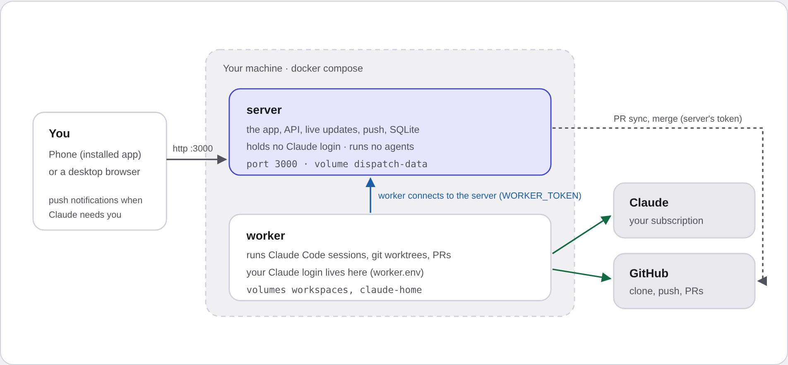
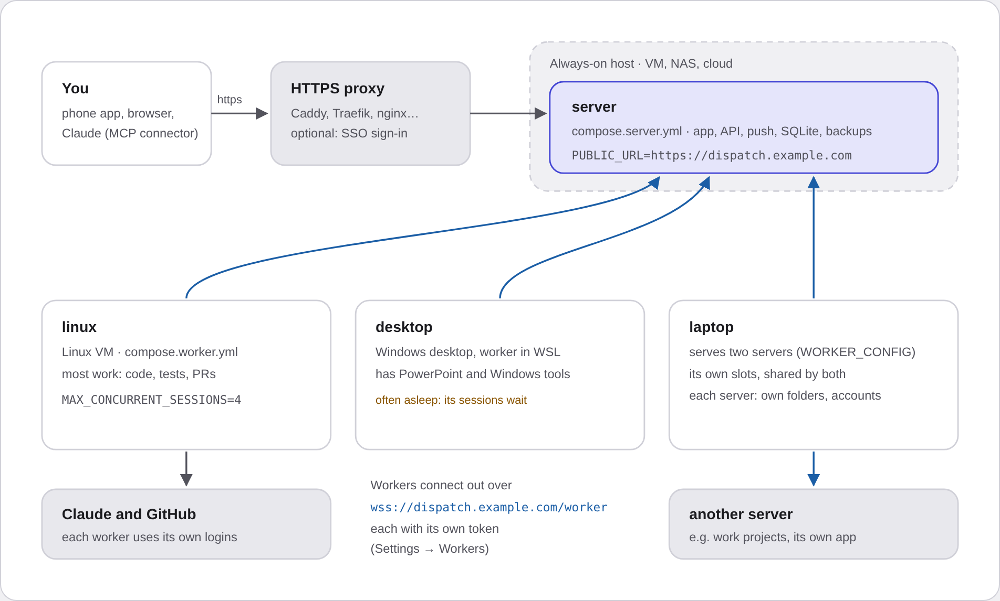
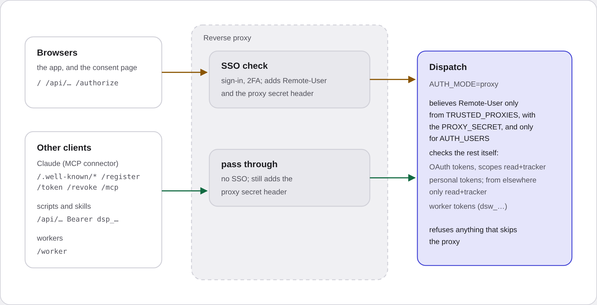

# Dispatch

A personal, Linear-style tracker for your projects that also runs **Claude Code** on them.

- Projects → one or more GitHub repos → backlog items and bugs, with per-project **importance**
  (4 levels) and **effort** (t-shirt by default) scales.
- **Sources**: capture a retro, skill-run report or user report (reporter + version tag), and split
  it into linked items, by hand or with Claude.
- Mark items and **start a batch**: one Claude Code session (with superpowers) works on one branch
  and opens one PR per changed repo.
- Or open a **planning chat**: Claude reads the code and the tracker and proposes the next batch as
  a card you edit and start.
- Sessions are normal multi-turn Claude Code. Claude's questions and plan approvals show up as
  cards, with a **push notification** to your phone. **Activity** shows all running work across
  projects.
- Review the PR diff on your phone and **merge** on GitHub, or merge locally on the worker and push.
- An **Assistant** tab (Haiku by default) that runs the tracker for you: "new project Decks for
  github.com/me/decks", "read ~/notes/retro.md and file the issues under Decks". It changes
  projects, repos, items and sources at once. To start agent work it shows a card you confirm. It
  can read files only in `ASSISTANT_READ_DIRS` and cannot edit files or run commands.
- **Discuss this** on any item: a read-only Haiku chat (`DISCUSS_MODEL`) that knows the item and the
  repo's `CLAUDE.md`, and can read the code in the project's repos (or the folder an imported source
  came from). It never changes anything; starting work stays on the item page.
- **Local repos** (no GitHub): add a project repo as a folder path (inside `LOCAL_REPO_DIRS`).
  Agents push their branches into that folder; Dispatch shows the branch for review (diff on the
  phone) and merges it by pushing the default branch back (the folder's working tree must be clean;
  set `receive.denyCurrentBranch updateInstead` there if the branch is checked out).
- **Accounts**: several GitHub accounts (a project picks one; its repos and commits use it) and several
  Claude accounts (a project has a default and an allowed list; a batch can pick another allowed one; a
  session keeps its account). SSO accounts log in once with `CLAUDE_CONFIG_DIR=… claude`. The Assistant
  has its own account setting. Secrets stay in env; see `.env.example`.
- Links in item text open in the app: repo files (markdown rendered, images shown), and `#anchor`
  links to other items imported from the same backlog.

Design spec: [`docs/superpowers/specs/2026-10-14-dispatch-design.md`](docs/superpowers/specs/2026-10-14-dispatch-design.md).

## Getting started

Dispatch has two parts. The **server** is the app you open (projects, backlog, sessions, push
notifications) and keeps the data; it holds no Claude login and runs no agents. A **worker** runs
the Claude Code sessions, with your Claude login and git, and connects *out* to the server. Run both
on one machine to start; add workers on other machines when you need them.

| You want | Use |
|---|---|
| To try it, or one always-on box | [One machine with Docker](#one-machine-with-docker) |
| The app always up, agents on the machines that have the tools (a Windows desktop with Office, a Linux VM) | [Distributed setup](#distributed-setup) |
| Sign-in through your SSO (Authelia, Authentik, …) | [Sign-in behind a proxy](#sign-in-tokens-and-claude-connectors) |

Illustrations (open the HTML files for light and dark versions):
[one machine](docs/illustrations/one-machine.html) ·
[distributed](docs/illustrations/distributed.html) ·
[behind a sign-in proxy](docs/illustrations/proxy-routes.html).

### One machine with Docker



You need Docker with Compose, a Claude subscription (or an API key), and optionally a GitHub token.

```bash
git clone https://github.com/<you>/dispatch && cd dispatch
cp docker/server.env.example server.env
cp docker/worker.env.example worker.env
# one shared secret between the two:
T=$(openssl rand -hex 32)
for f in server.env worker.env; do sed "s/^WORKER_TOKEN=.*/WORKER_TOKEN=$T/" $f > $f.new && mv $f.new $f; done
```

1. In `server.env`, set `APP_PASSWORD`, and `GITHUB_TOKEN` if you use GitHub (a fine-grained token
   with *Contents* read/write, *Pull requests* read/write and *Checks* read, on your repos).
2. In `worker.env`, set `CLAUDE_CODE_OAUTH_TOKEN`: run `claude setup-token` on your own computer and
   paste the token (to bill the API instead, set `ANTHROPIC_API_KEY`). Set the same `GITHUB_TOKEN`
   and your commit name and email. To try the app without using Claude, set `RUNNER=fake`.
3. Start it and open the app:

   ```bash
   docker compose up -d --build
   open http://localhost:3000            # sign in with APP_PASSWORD
   ```

4. Make a project, add a repo (`owner/name`), add a few items, and start a batch, or ask the
   planner what to do next (**Plan** on the project).

The **phone app** and **push notifications** need HTTPS: put a reverse proxy in front and set
`PUBLIC_URL` to the https address ([Caddy example](docs/examples/Caddyfile)). Then open the address
on the phone and add it to the home screen. Data is in the Docker volumes (`dispatch-data` for the
server, `workspaces` and `claude-home` for the worker).

### Distributed setup



**1. The server**, on an always-on host (a VM, a NAS, a cloud box):

```bash
cp docker/server.env.example server.env    # APP_PASSWORD, PUBLIC_URL=https://dispatch.example.com, GITHUB_TOKEN
docker compose -f compose.server.yml up -d --build
```

Put HTTPS in front ([Caddy example](docs/examples/Caddyfile)); the worker socket `/worker` and live
updates are ordinary WebSocket/HTTP traffic and pass through. `compose.server.yml` also runs a
nightly backup of the database into `./backups` (14 days kept). `WORKER_TOKEN` in `server.env` is
optional here: workers get their own tokens.

**2. A worker for each machine.** In the app, **Settings → Workers → New worker**: give it a name
(`linux`, `desktop`) and a description the planner reads ("Windows desktop, has PowerPoint, often
asleep"). Copy the token it shows once (`dsw_…`).

*With Docker* (a Linux VM, a server):

```bash
cp docker/worker.env.example worker.env
# SERVER_WS_URL=wss://dispatch.example.com/worker, WORKER_TOKEN=dsw_…, CLAUDE_CODE_OAUTH_TOKEN, GITHUB_TOKEN
docker compose -f compose.worker.yml up -d --build
```

*Without Docker* (a desktop, so agents can use its programs; under WSL they can run Windows tools
such as PowerPoint): Node 24 or newer and git, then

```bash
git clone https://github.com/<you>/dispatch ~/dispatch && cd ~/dispatch && npm ci --omit=dev
cp docker/worker.env.example ~/.config/dispatch/worker.env    # SERVER_WS_URL, WORKER_TOKEN=dsw_…
```

and run it as a service with [this systemd unit](docs/examples/dispatch-worker.service). Without
`CLAUDE_CODE_OAUTH_TOKEN`, a worker on your own machine uses your normal Claude Code login.

The worker shows as online in **Settings → Workers**. On each project, **Settings → Where work runs**
sets its default worker and the rules the planner follows when it proposes where a batch runs. A
session for a worker that is asleep waits in the queue and starts when the worker connects.

**One worker, several servers** (separate environments, each with its own server and app): give the worker a
[`worker.json`](docs/examples/worker.json) with one entry per server (address, token file, the
folders and accounts that server may use) and set `WORKER_CONFIG` to its path. Its session limit
counts over all servers.

### Repos hosted by Dispatch

A project's repo can live on GitHub, in a folder on one worker (a local repo), or in Dispatch itself.
A **hosted** repo is kept by the server (`DATA_DIR/git`, included in the nightly backup):

- Add it in the project's **Settings → Repos → Keep the repo in Dispatch**: empty, or copied from
  a GitHub repo.
- Workers clone it from the server and push their session branches back to it
  (`/git/r<id>.git`, with their worker token), so it works with any worker, also one that has no
  GitHub access.
- You review the branch in Dispatch (files and diffs) and **Merge** there; the server merges, with
  no worker needed. With a check command, the session's worker merges instead and runs the check
  first.
- Optionally link a **GitHub repo** (for example on an enterprise GitHub): every merge in Dispatch
  is pushed to it, or you can **Open a PR on GitHub instead** and review there. When that PR is
  merged, the result comes back into Dispatch's repo.

For an enterprise GitHub, set `GITHUB_GIT_BASE` and `GITHUB_API_URL` on the server. Behind a sign-in
proxy, route `/git/` around the browser sign-in like `/worker`.

## Configuration

All settings are environment variables (`server.env`, `worker.env`). Any secret can also come from a
file: `NAME_FILE=/run/secrets/name` (swarm and Kubernetes secrets).

**Server**

| Variable | Default | What it does |
|---|---|---|
| `PUBLIC_URL` | `http://localhost:3000` | The address you open the app on. https for the phone app, push and the Claude connector. |
| `APP_PASSWORD` / `APP_PASSWORD_HASH` | | Sign-in password (hash: `node src/server/hash-password.ts 'pw'`). |
| `WORKER_TOKEN` | | Token of the worker "default". Other workers get tokens in Settings → Workers. |
| `GITHUB_TOKEN` or `GITHUB_ACCOUNTS` + `GITHUB_ACCOUNT_<NAME>_TOKEN` | | The server follows PRs and merges with it. |
| `VAPID_SUBJECT` | `mailto:admin@example.com` | Sender of push notifications. |
| `PORT`, `DATA_DIR` | `3000`, `./data` | Where it listens and keeps the database. |
| `GITHUB_POLL_SECONDS` | `120` | How often PRs are checked. |
| `GITHUB_GIT_BASE`, `GITHUB_API_URL` | `https://github.com`, `https://api.github.com` | Another GitHub (enterprise) for hosted repos' upstreams. |
| `AUTH_MODE` | `password` | `proxy` behind a sign-in proxy; `DISABLE_AUTH=1` turns sign-in off (testing only). |
| `TRUSTED_PROXIES`, `AUTH_USERS`, `AUTH_HEADER`, `PROXY_SECRET`, `PROXY_SECRET_HEADER` | | Proxy mode, see [Sign-in](#sign-in-tokens-and-claude-connectors). |
| `TOKEN_REMOTE_SCOPES` | `read,tracker` | What personal tokens may do from another machine. |

**Worker**

| Variable | Default | What it does |
|---|---|---|
| `SERVER_WS_URL` | `ws://localhost:3000/worker` | The server's worker socket (`wss://…/worker` behind HTTPS). |
| `WORKER_TOKEN` | | The worker's token (`dsw_…`, or the server's `WORKER_TOKEN` for "default"). |
| `WORKER_CONFIG` | | A JSON file for a worker that serves several servers ([example](docs/examples/worker.json)). |
| `MAX_CONCURRENT_SESSIONS` | `3` | Agent sessions at once on this worker (over all its servers). |
| `CLAUDE_CODE_OAUTH_TOKEN` / `ANTHROPIC_API_KEY` | | Claude login. Without either: the machine's own Claude Code login. |
| `CLAUDE_ACCOUNTS` + `CLAUDE_ACCOUNT_<NAME>_…` | | Several Claude accounts (see `.env.example`). |
| `GITHUB_TOKEN` or `GITHUB_ACCOUNTS` + … | | Clone, push and open PRs. |
| `GIT_AUTHOR_NAME`, `GIT_AUTHOR_EMAIL`, `GIT_COMMITTER_…` | | Commit identity. |
| `WORKSPACES_DIR` | `./data/workspaces` | Clones and session worktrees. |
| `LOCAL_REPO_DIRS` | | Folders that may hold local repos (no GitHub); off when empty. |
| `ASSISTANT_READ_DIRS` | | Folders the Assistant and imports may read. |
| `AGENT_MODEL`, `ASSISTANT_MODEL`, `DISCUSS_MODEL` | Claude Code default, `haiku`, `haiku` | Models. |
| `AGENT_PLUGIN_DIRS`, `AGENT_SETTING_SOURCES` | (the image adds superpowers) | Plugins and which Claude settings agents load. |
| `AGENT_EXTRA_PATH`, `WINDOWS_PATH` | | Tool folders for agents; under WSL the Windows PATH is added unless `WINDOWS_PATH=off`. |
| `IDLE_CLOSE_MINUTES` | `10` | Close an idle Claude process after this long (it resumes on the next message). |
| `RUNNER` | `claude` | `fake`: a scripted agent, to try the app without Claude. |

## Architecture

```
server  (Fastify, node:sqlite, web-push, Octokit)  — API, PWA, SSE live updates, GitHub sync/merge
  ⇅ internal WebSocket (WORKER_TOKEN)
worker  (Claude Agent SDK, git, gh)                — Claude sessions, git worktrees, local merges
web/    (React, Vite, Tailwind, vite-plugin-pwa)    — mobile-first PWA, built into dist/web
```

The server holds no Claude credentials. The worker runs agents with full tool access inside its
container, routes `AskUserQuestion` / `ExitPlanMode` to you, and keeps each session in its own
worktree under `/workspaces/sessions/<id>`.

## Several workers

A server can have several workers, for example a Linux VM for most work and a Windows desktop
(in WSL) for work that needs its programs. Each session runs on one worker for its whole life.

- **Make a worker** in Settings → Workers. It gets its own token (`dsw_…`, shown once) and a
  description, such as "Windows desktop. Has PowerPoint. Often asleep." The worker that connects
  with the server's `WORKER_TOKEN` is the worker "default"; it keeps working as before.
- **Placement.** Each project has a default worker and a "Where work runs" text. The planner reads
  the worker descriptions and that text, and proposes a worker on its card; you can change it on
  the card and on the batch sheet. A project's local repos are on one worker, so its sessions run
  there.
- **Away or busy.** A session for a worker that is not connected waits (`Waiting for worker
  <name>`), with one push, and starts when the worker connects. A worker with no free slot gives
  `Waiting for worker <name> (busy)`. A reply to an idle session waits too. You can pause a waiting
  session, and move it to another worker (a started work session moves as a new session that
  continues from its pushed branch).
- **Logins stay on the worker.** Each worker uses its own Claude login and GitHub token. The
  server never sends credentials to a worker.

**A worker that serves several servers** (separate environments, each with its own server) reads a
JSON file named by `WORKER_CONFIG`. The worker owns its slots (`max_concurrent`, over all
servers), and each server gets only the folders and accounts listed for it:

```json
{
  "max_concurrent": 3,
  "servers": [
    { "name": "server-a", "url": "wss://dispatch-a.example.com/worker", "token_file": "~/.config/dispatch/worker-server-a.token",
      "local_repo_dirs": ["~/repos/a"], "read_dirs": ["~/repos/a"] },
    { "name": "server-b", "url": "wss://dispatch-b.example.com/worker", "token_file": "~/.config/dispatch/worker-server-b.token",
      "local_repo_dirs": ["~/repos/b"], "claude_accounts": ["account-b"], "github_accounts": ["account-b"] }
  ]
}
```

These lists stop a server from asking for the wrong folder or account. They do not keep the agents
of one server from reading the other server's files on the same machine: agents have full tool
access. Use separate machines (or users) when that matters. Without `WORKER_CONFIG`, the worker
uses `SERVER_WS_URL`, `WORKER_TOKEN`, `LOCAL_REPO_DIRS` and `ASSISTANT_READ_DIRS` as one server.

## Releases

A project page shows **Release** when a connected worker can release one of the project's repos.
The sheet shows:
- the last release
- the done items since then
- a proposed version, which you can edit
- the release step the worker will run

**Create release** starts a release session on that worker. Claude reads the repo's release rules
(CLAUDE.md, AGENTS.md, `.dispatch.md`), writes and commits the changelog entry, and runs the release
with exactly that version. Only after the release succeeds does it label the items
`<prefix><version>` (e.g. `rel:v1.5.0`). If a step fails, it stops, labels nothing and asks you.

Which releases a worker can run is set in the worker's own config, so a release that needs a
credential on one machine is offered only there. Add `releases` to a server entry in
`WORKER_CONFIG`, or set `RELEASES` to the same JSON list without a config file:

```json
"releases": [
  { "repo": "me/slides", "label_prefix": "rel:", "command": "tools/release.sh {version}" },
  { "repo": "me/slides-convert", "label_prefix": "convert:" },
  { "repo": "~/projects/desktop-app", "command": "./release.sh {version} --yes",
    "notes": "The upload credential is on this machine." }
]
```

- **`repo`** can be `owner/name`, a repo name that is unique in the project, or the path of a local
  repo on this worker. Repos hosted by Dispatch cannot be released yet.
- **`label_prefix`** defaults to `rel:`. Use different prefixes for separate release lines in one
  project.
- **`command`** is optional, and `{version}` in it is replaced with the version. Without a command,
  Claude follows the repo's documented steps, or tags and pushes. The worker always uses its own
  `command` and `notes`, never ones sent by the server.
- **The proposed version** starts from the newest of these:
  - the repo's latest version tag on the default branch
  - its `VERSION` file
  - the project's labels with that prefix

  It then bumps the minor number when the done items include backlog work, and the patch number
  for bug fixes only. A version you type without `v` follows the style of the last release.
- **Where it runs.** A local repo is released in your own checkout, which must be on its default
  branch with no uncommitted changes. A GitHub repo is released in a checkout of the default branch
  on the worker. One release per repo runs at a time.

## Run without Docker (development)

Node 24+ (runs TypeScript directly, no build step for server/worker).

```bash
npm install
npm run build                      # PWA → dist/web (or use npm run dev:web on :5173)
APP_PASSWORD=dev WORKER_TOKEN=dev npm run dev:server
WORKER_TOKEN=dev RUNNER=fake npm run dev:worker
```

Without `RUNNER=fake` the worker uses your local Claude Code login. Set
`AGENT_PLUGIN_DIRS=~/.claude/plugins/cache/claude-plugins-official/superpowers/<version>` to load
superpowers, and `AGENT_SETTING_SOURCES=project` if you don't want your personal `~/.claude`
settings in agent sessions.

## Sign-in, tokens and Claude connectors



Dispatch needs no other infrastructure: by default you sign in with a password (`AUTH_MODE=password`,
`APP_PASSWORD` or `APP_PASSWORD_HASH`). `DISABLE_AUTH=1` turns sign-in off for local testing.

**Behind a sign-in proxy** (e.g. Traefik with an SSO forward-auth): set `AUTH_MODE=proxy`,
`TRUSTED_PROXIES` to the proxy's address(es) (IPs or IPv4 CIDRs) and optionally `AUTH_USERS` to the
users allowed in (`AUTH_HEADER`, default `Remote-User`, names the user). Set `PROXY_SECRET` too and have
the proxy add it to every request (header `X-Proxy-Secret`): everything else on the proxy's host has
its address, and the secret is what tells the proxy apart. A tunnel or proxy on Dispatch's own machine
makes every request look local (full token scopes, password login): do not run one there. Dispatch then believes the
header only from those addresses, refuses every other request that does not come from the machine
itself (so the port is no way around the proxy), and keeps the password login for that machine
only, as a way in when the proxy is down. When the proxy's session expires the app shows
"Signed out" and sends you through `/signin`, which the proxy guards.

**Scopes.** Every API route needs one: `read`, `tracker` (items, comments, sources, images),
`sessions` (start and steer agents, merge) or `admin` (projects, repos, settings). A signed-in person
has all of them.

**Tokens** for scripts and skills: Settings → Tokens. A token has a name, scopes (`tracker` by
default), an optional expiry and a last-used time, is shown once and stored only as a hash, and can
be revoked on its own. Used from another machine, a token only gets `read` and `tracker`
(`TOKEN_REMOTE_SCOPES`), so a leaked token cannot start agents from outside. Making tokens needs a
signed-in person; a token cannot make tokens.

**Claude connector (MCP).** `PUBLIC_URL/mcp` is an MCP server with the tracker tools (list, read,
add and edit items, comments, sources, images, release labels; nothing that starts agents). Add it
as a connector in Claude (claude.ai, the apps, Claude Code: `claude mcp add --transport http dispatch
https://dispatch.example.com/mcp`). Claude registers itself, you approve it once on a consent page
(signed in as above), and it renews its access by itself (24 h access, 60-day rotating refresh
tokens). Settings → Connected apps lists them and disconnects them.

Behind a proxy, route these paths **around** the proxy's sign-in, because the client is not a
browser: `/.well-known/*`, `/register`, `/token`, `/revoke` and `/mcp`; and, for tokens,
`/api/*` requests that carry `Authorization: Bearer dsp_…`; `/worker` (the WebSocket that
workers on other machines connect to, with their worker token); and `/git/` (hosted repos, also with
worker tokens). Keep `/authorize` (the consent
page) and everything else **behind** it. Dispatch checks all of these itself.

## Tools for agents

Agents use the tools on the worker's PATH. Put extra tool folders first with `AGENT_EXTRA_PATH`
(e.g. `~/.local/go/bin` for a Go install). Under WSL the worker also adds Windows' own PATH, as
a Windows terminal does, so agents can run `powershell.exe` (and through it PowerPoint) and other
Windows tools; a worker started by systemd does not get that PATH otherwise. `WINDOWS_PATH=off`
turns it off. The worker logs what it added when it starts.

## Phone and push notifications

Push needs HTTPS, and on iPhone the app must be added to the home screen (Share → Add to Home
Screen) and opened from there. For local testing, expose the server over HTTPS, e.g.
`tailscale serve 3000` or `cloudflared tunnel --url http://localhost:3000`, set `PUBLIC_URL` to
that address, then turn on notifications in **Settings**. VAPID keys are generated on first start
and kept in the database.

You get a push when Claude asks a question, needs a plan approved, finishes a turn, proposes a
batch, opens a PR, or fails. Mute per project in project settings.

## Posting retros from skills or scripts

```bash
curl -X POST "$DISPATCH/api/projects/HC/sources" \
  -H "Authorization: Bearer $DISPATCH_TOKEN" -H 'content-type: application/json' \
  -d '{"kind":"skill_run","title":"Slideshow run retro","reporter":"alex","version_tag":"v6.4.1",
       "skill_name":"deck-builder","body_md":"…full retro…",
       "items":[{"type":"bug","title":"Fonts wrong in Edge","importance":3,"effort":1}]}'
```

The API token is on the Settings page. `items` is optional; you can split later in the app.

## Claude Code skill: keep the backlog in Dispatch

`skills/dispatch-backlog` lets Claude Code manage a repo's backlog and changelog in Dispatch rather
than in a markdown file. It reacts to backlog, bug and changelog requests ("file a bug", "what's
next", "write the release notes", item keys like HC-42), and works through a small script
(`scripts/dispatch.mjs`, no dependencies).

1. Install it for your user: `ln -s "$PWD/skills/dispatch-backlog" ~/.claude/skills/dispatch-backlog`
2. Token: copy the API token from Settings into `~/.config/dispatch/tokens/<host>`, with `:` as
   `_` (e.g. `tokens/localhost_3000`), `chmod 600`. One file per server.
   Dispatch is assumed on `http://localhost:3000`; a repo names another server with `url:` in its
   `.dispatch.md` (`DISPATCH_URL` overrides it for the whole machine).
3. In each repo, add `.dispatch.md` (start from `skills/dispatch-backlog/dispatch.example.md`): the
   project key in the frontmatter, then your rules for naming, tags, modules and the changelog.

Items can carry images (screenshots, rendered output): add them in the app (camera, photo
library, file, or paste on desktop) or with the script. `images:` in `.dispatch.md`
(`always`, `when_possible`, `off`) says how hard Claude tries to attach an example image that
shows the issue, and the text below it can say how to make one. Agents working on an item can
look at its images.

The changelog stays a file in the repo. Claude writes it from done items without a `rel:<version>`
label, then labels them, so the next entry starts where this one ended.

## Backups

`node src/server/backup.ts --data /data --out /backups --at 03:15 --keep 14` runs in the server
image as a second service (`compose.server.yml` includes it) and makes, once a night, an online copy of
the SQLite database (consistent while the server runs) and a tarball of the attachments. It keeps
14 days. `--once` makes one copy now. Restore: stop the server, put the `.db` copy in place as
`dispatch.db` (remove any `-wal`/`-shm` files next to it) and unpack the attachments.

## Tests

```bash
npm test                      # vitest: API, session flow with fake worker, git workspaces
npm run e2e                   # Playwright, iPhone viewport, against dist/web + fake worker
npm run typecheck
```

Set `CHROMIUM_PATH` if Playwright's own browser isn't installed.
